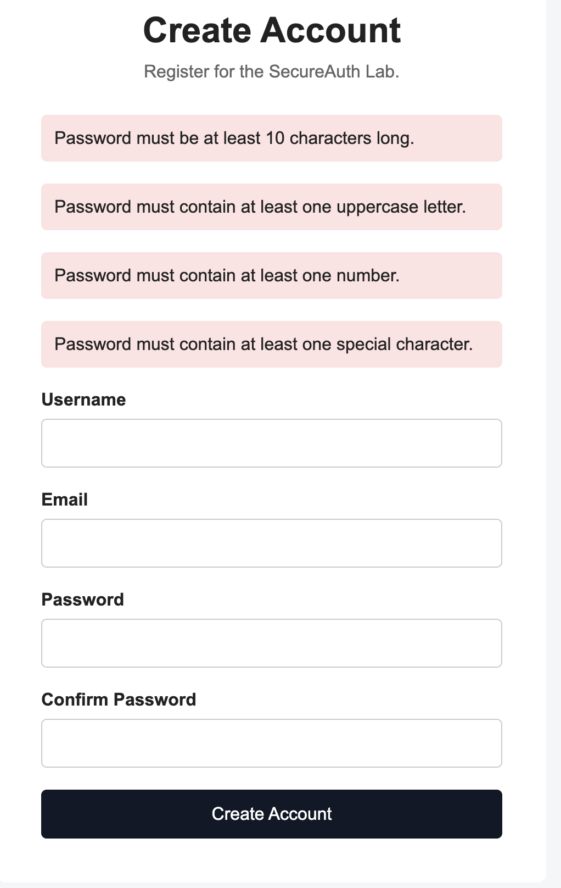
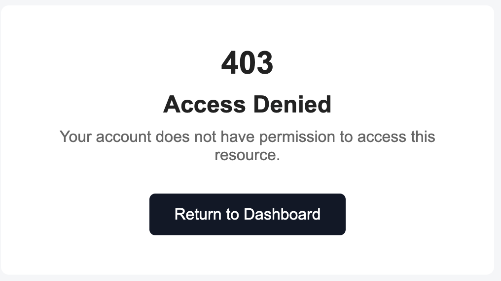
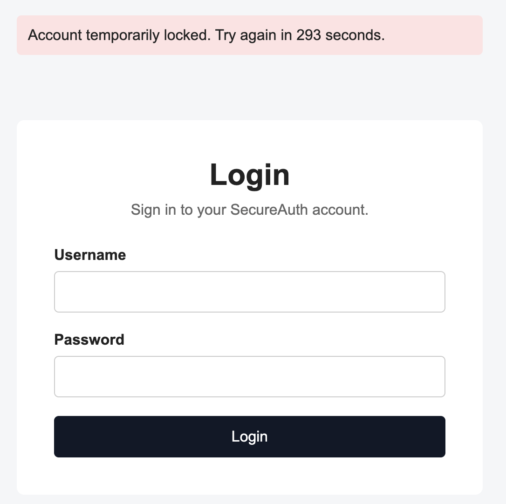
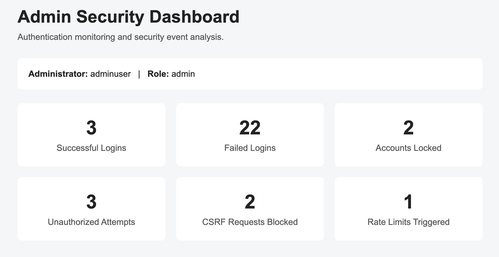
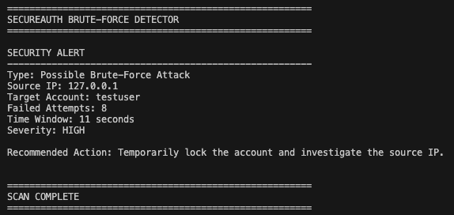
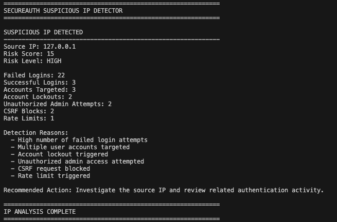
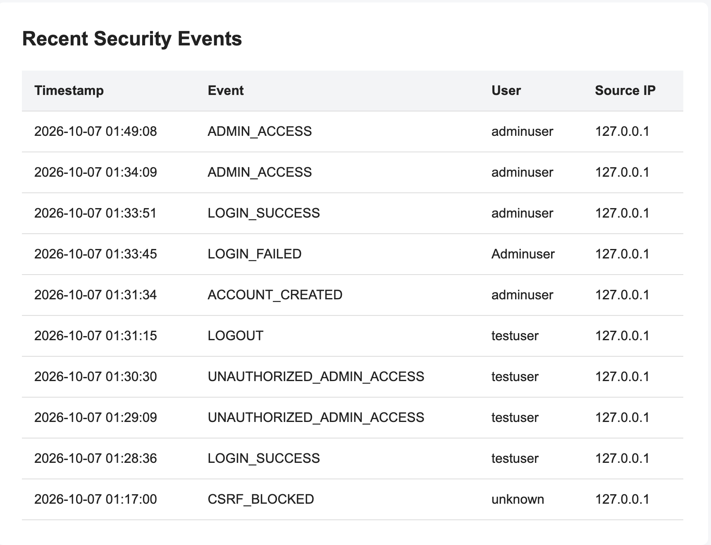

# SecureAuth Lab: Web Application & Authentication Security

A Python Flask application demonstrating **secure authentication, layered web application defenses, and security event monitoring**. It combines preventive controls such as role-based access control and login rate limiting with custom Python scripts that analyze authentication logs for suspicious activity.

> **Scope:** This is an educational security lab tested in a controlled local environment, not a production security assessment.

## Key Features

| Area | Implementation |
| --- | --- |
| Password security | bcrypt password hashing and password complexity checks |
| Authentication | Flask-Login sessions and protected routes |
| Session protection | HTTPOnly and SameSite cookies, 30-minute session lifetime, environment-based secret key |
| Authorization | Role-based access control (RBAC) for users and administrators |
| Brute-force defense | Temporary account lockout after 5 failed logins and IP-based request rate limiting |
| CSRF defense | Flask-WTF CSRF tokens for login and registration forms |
| Database access | SQLAlchemy ORM with a SQLite database |
| Event monitoring | Authentication and security events recorded in `auth.log` |
| Threat detection | Python log analysis, brute-force alerts, and suspicious IP risk scoring |
| Admin visibility | Admin-only dashboard summarizing security activity and recent events |

## Tech Stack

- **Languages:** Python, HTML, CSS
- **Web framework:** Flask
- **Security and authentication:** Flask-Login, Flask-WTF, Flask-Limiter, bcrypt
- **Database:** SQLite with SQLAlchemy ORM
- **Development tools:** Git, GitHub, VS Code

## How It Works

1. A user registers or logs in through the Flask web application.
2. The application validates passwords, manages authenticated sessions, and enforces access permissions.
3. Account lockout, request rate limits, and CSRF validation help block suspicious or unauthorized requests.
4. Security activity is logged to `auth.log`, including failed logins, lockouts, CSRF violations, rate-limit triggers, and unauthorized admin access.
5. Custom Python scripts analyze event data for brute-force patterns and suspicious source IPs.
6. The administrator dashboard displays security statistics and recent events.

## Security Controls

### Secure Authentication and Authorization

- Uses **bcrypt** to hash passwords before database storage.
- Enforces passwords with **at least 10 characters**, an uppercase letter, a lowercase letter, a number, and a special character.
- Uses **Flask-Login** to restrict protected pages to authenticated users.
- Separates user and administrator permissions using **RBAC**; unauthorized admin access returns **HTTP 403** and is logged.
- Configures HTTPOnly and SameSite session cookies, a 30-minute session lifetime, and a secret key supplied through an environment variable.

### Login and Application Attack Protection

- Temporarily locks an account after **5 failed login attempts**.
- Applies source-IP-based login rate limiting; excess requests return **HTTP 429 Too Many Requests**.
- Uses Flask-WTF CSRF tokens on login and registration forms and logs invalid-token requests.
- Uses SQLAlchemy ORM for database interaction to reduce SQL injection risk. Tested SQL-injection-style login inputs did not bypass authentication in the documented local tests.

## Detection and Monitoring

### Authentication Log Analysis

The application records event types such as successful and failed logins, account lockouts, rate-limit triggers, CSRF violations, and unauthorized administrative access in `auth.log`. A Python analyzer summarizes event counts, source IP activity, and usernames targeted by failed logins.

### Brute-Force Detection

A standalone Python detector correlates **username, source IP, and timestamps**. It raises a **HIGH-severity alert when 5 failed login attempts occur within 60 seconds**.

### Suspicious IP Risk Scoring

A second Python script groups events by source IP and assigns a **LOW, MEDIUM, or HIGH** risk classification based on signals including:

- Failed login attempts and multiple usernames targeted
- Account lockouts
- Unauthorized administrator access attempts
- CSRF violations and rate-limit triggers

### Administrator Dashboard

The admin-only dashboard displays summary counts for successful/failed logins, account lockouts, unauthorized access attempts, blocked CSRF requests, and rate-limit events. It also displays recent events with timestamps, event types, usernames, and source IPs.

## Screenshots

*Screenshots are taken from the project's local test environment.*

**Registration and password validation**

**Unauthorized administrator access blocked (HTTP 403)**

**Temporary account lockout**

**Administrative security overview**

**Brute-force detector output**

**Suspicious IP risk analysis**

**Recent security events**

## Security Testing and Results

The following tests were documented in a controlled local environment:

| Test | Observed result |
| --- | --- |
| Weak password submitted | Rejected by password policy |
| Unauthenticated user requests a protected page | Redirected to login |
| Standard user requests an admin-only page | Blocked with HTTP 403 |
| Repeated failed authentication attempts | Account temporarily locked |
| Excessive login requests from a source IP | HTTP 429 Too Many Requests |
| Form submission with an invalid/missing CSRF token | Request blocked and logged |
| SQL-injection-style authentication bypass attempt | Authentication bypass rejected |
| Brute-force pattern | HIGH-severity alert generated |
| Suspicious IP activity | Risk score assigned and classified as HIGH in the documented test |

